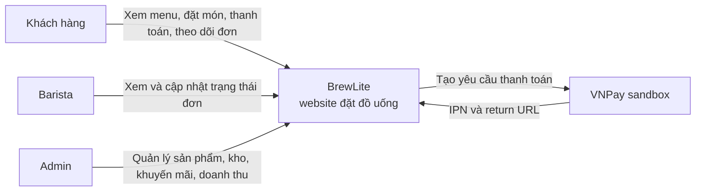
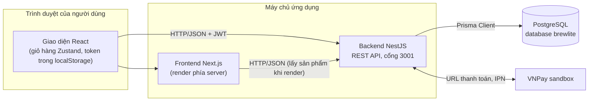
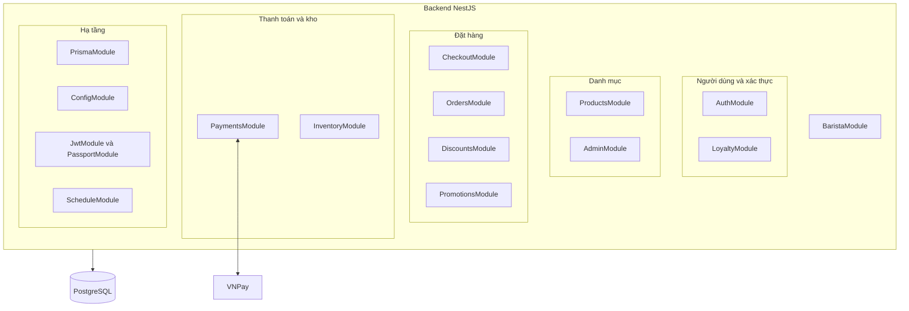
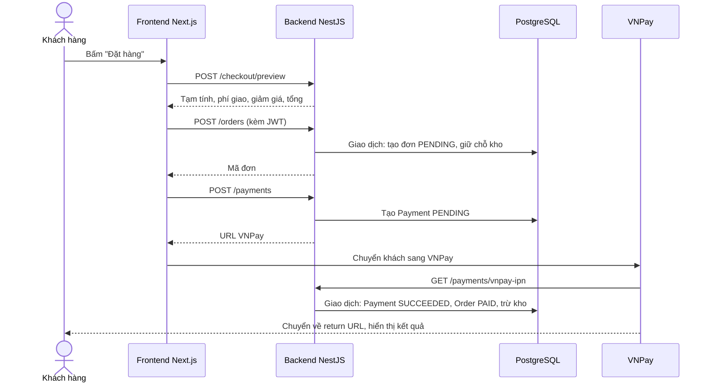

# Kiến trúc hệ thống BrewLite: Tổng quan (Task 3.1)

BrewLite là **một hệ thống ba tầng triển khai thành hai ứng dụng và một cơ sở dữ liệu**, đặt chung trong một repository (monorepo):

| Khối | Công nghệ | Vai trò |
|------|-----------|---------|
| Frontend | Next.js (App Router), React, TypeScript, TailwindCSS, Zustand | Giao diện cho khách hàng, Barista, Admin |
| Backend | NestJS (TypeScript), Passport + JWT, `@nestjs/schedule` | REST API, nghiệp vụ, phân quyền, tác vụ định kỳ |
| Cơ sở dữ liệu | PostgreSQL, Prisma ORM, Prisma Migrate | Lưu dữ liệu, giao dịch (transaction), lịch sử migration |
| Thanh toán | VNPay (sandbox) | Dịch vụ thanh toán mô phỏng, không phát sinh tiền thật |
| Môi trường | Docker, pnpm | Chạy hạ tầng dev thống nhất (xem ADR-009) |

Kiểu kiến trúc backend: **modular monolith**, nghĩa là một ứng dụng NestJS duy nhất, chia module theo domain (đơn hàng, thanh toán, kho, khuyến mãi...).

### 2.1 Yêu cầu quyết định kiến trúc

| Động lực | Từ đâu | Ảnh hưởng đến kiến trúc |
|----------|--------|-------------------------|
| Đặt hàng phải nguyên tử: tạo đơn, giữ kho, ghi mã giảm giá, trừ điểm | NFR-10, NFR-11 | Dùng một cơ sở dữ liệu quan hệ có transaction; không tách microservice (ADR-002, ADR-004, ADR-007) |
| Phân quyền CUSTOMER, BARISTA, ADMIN | FR-04, NFR-05, NFR-06 | JWT + guard theo vai trò (ADR-005) |
| Thanh toán trực tuyến, không ghi nhận trùng | FR-26 đến FR-29, NFR-07 | VNPay, IPN, idempotency (ADR-006) |
| Tự hủy đơn quá 10 phút | FR-24 | Tác vụ định kỳ và cơ chế giữ chỗ (ADR-007) |
| Nhóm sinh viên, nhiều người làm song song, một số người mới học công nghệ | Bối cảnh Task 1.1 | Giữ kiến trúc đơn giản, một repo, quy ước rõ (ADR-001, ADR-002) |
| Dựng và chạy được trên máy sạch | NFR-19 đến NFR-21 | Docker, biến môi trường, migration và seed (ADR-009, ADR-010) |

## 3. C4 mức 1: Bối cảnh hệ thống

| Thành phần | Mô tả |
|------------|-------|
| Khách hàng, Barista, Admin | Ba vai trò người dùng của hệ thống (xem mục tác nhân trong `use-case-dat-va-thanh-toan.md`) |
| BrewLite | Hệ thống đang xây dựng |
| VNPay | Hệ thống ngoài, nhận yêu cầu thanh toán và gọi ngược về BrewLite khi có kết quả |

## 4. C4 mức 2: Container

| Container | Công nghệ | Trách nhiệm | Giao tiếp |
|-----------|-----------|-------------|-----------|
| Giao diện trong trình duyệt | React (client component) | Giỏ hàng, form đăng nhập, chọn size/topping, trang đơn hàng | Gọi API qua `lib/api.ts`, gửi JWT lấy từ `localStorage` (khóa `accessToken`) |
| Frontend Next.js | Next.js App Router | Định tuyến trang, render phía server (ví dụ trang menu gọi `getProducts`), phục vụ tài nguyên tĩnh (ảnh trong `public/images`) | Gọi REST API của backend |
| Backend NestJS | NestJS, Passport, Prisma | Nghiệp vụ, phân quyền, tính giá, giữ kho, thanh toán, tác vụ định kỳ, tài liệu Swagger (`/api`) | Nhận HTTP từ frontend và VNPay; truy cập PostgreSQL; gọi sang VNPay |
| PostgreSQL | PostgreSQL | Lưu trữ dữ liệu quan hệ, bảo đảm ACID | Chỉ backend được truy cập |
| VNPay | Dịch vụ ngoài | Xử lý thanh toán | Nhận URL thanh toán; gọi IPN và chuyển hướng return URL về backend |

## 5. C4 mức 3: Thành phần của backend

Backend chia module theo domain. Các module dưới đây khớp với log khởi động của ứng dụng.

| Module | Trách nhiệm | Điểm vào (route) |
|--------|-------------|------------------|
| AuthModule | Đăng ký, đăng nhập, đăng xuất, cấp và kiểm tra JWT | `/auth/register`, `/auth/login`, `/auth/logout` |
| ProductsModule | Danh sách và chi tiết sản phẩm | `/products`, `/products/:id` |
| CheckoutModule | Xem trước đơn (tính tạm tính, phí giao, giảm giá, tổng) | `/checkout/preview` |
| OrdersModule | Tạo đơn, đơn của tôi, hủy đơn; tác vụ tự hủy đơn quá hạn | `/orders`, `/orders/me`, `/orders/:id/cancel` |
| PaymentsModule | Tạo thanh toán, hủy thanh toán, nhận IPN và return URL của VNPay | `/payments`, `/payments/orders/:orderId/cancel`, `/payments/vnpay-ipn`, `/payments/vnpay-return` |
| DiscountsModule | Kiểm tra và tính giảm giá khi đặt đơn, ghi lượt dùng mã (`PromotionUsage`) | (dùng nội bộ) |
| PromotionsModule | Quản lý mã khuyến mãi (tạo, xem, sửa, tắt) | `/promotions` |
| LoyaltyModule | Điểm thưởng và lịch sử điểm | `/users/me/loyalty` |
| InventoryModule | Giữ chỗ và trừ kho nguyên liệu, topping | (dùng nội bộ) |
| BaristaModule | Danh sách đơn cần làm, đổi trạng thái chế biến | `/barista/orders`, `/barista/orders/:id` |
| AdminModule | Quản lý sản phẩm, nguyên liệu, topping, kho, báo cáo doanh thu | `/admin/...` |
| PrismaModule | Cung cấp `PrismaService` dùng chung | (hạ tầng) |

**[Cần xác nhận]** Quan hệ phụ thuộc giữa các module (ví dụ OrdersModule gọi DiscountsModule, InventoryModule, LoyaltyModule) nên được vẽ lại từ mã nguồn trước khi nộp. Bảng trên mô tả trách nhiệm, chưa vẽ mũi tên phụ thuộc.

### 5.1 Phân lớp bên trong mỗi module

| Lớp | Thành phần NestJS | Việc làm |
|-----|-------------------|----------|
| Giao tiếp | Controller, DTO | Nhận yêu cầu HTTP, kiểm tra dữ liệu vào, kiểm tra vai trò (guard), trả kết quả |
| Nghiệp vụ | Service | Quy tắc giá, khuyến mãi, giữ kho, vòng đời đơn và thanh toán |
| Truy cập dữ liệu | `PrismaService` | Truy vấn và giao dịch (`$transaction`) trên PostgreSQL |

Quy tắc: controller không chứa nghiệp vụ; service nhận `tx` (client giao dịch) khi cần chạy chung một transaction.

## 6. Kiến trúc frontend

| Thành phần | Mô tả |
|------------|-------|
| Định tuyến | Next.js App Router: `/` (menu), `/products/[id]`, `/cart`, `/orders`, `/login`, `/register`, `/about`, các trang Admin và Barista |
| Bố cục chung | `components/layout`: Header, Footer, SiteChrome; Header chỉ hiện logo ở trang đăng nhập và đăng ký |
| Truy cập API | `lib/api.ts`: hàm `request` dùng chung, ném `ApiError` (mã 0 khi không kết nối được máy chủ) |
| Trạng thái giỏ hàng | `lib/cart-store.ts`: store Zustand `useCartStore` và hook `useCart` tính tạm tính, phí giao, giảm giá, tổng |
| Xác thực | JWT lưu ở `localStorage` khóa `accessToken`, gửi kèm mỗi yêu cầu cần đăng nhập |
| Kiểu dữ liệu | `lib/types.ts` |
| Giao diện | TailwindCSS bám thiết kế Figma (nền `#F8F5F0`, rộng 1440px) |
| Ranh giới server/client | Trang menu lấy dữ liệu ở server component; giỏ hàng, đăng nhập chạy ở client component (`"use client"`) |

## 7. Kiến trúc dữ liệu

Cơ sở dữ liệu PostgreSQL `brewlite`, schema `public`, định nghĩa trong `prisma/schema.prisma`.

| Nhóm | Bảng (model) | Ghi chú |
|------|--------------|---------|
| Người dùng | `User`, `LoyaltyTransaction` | Vai trò (`CUSTOMER`, `BARISTA`, `ADMIN`), `tokenVersion`, điểm thưởng, điểm giữ chỗ |
| Danh mục và kho | `Product`, `Ingredient`, `Recipe`, `Topping` | `Recipe` nối món với nguyên liệu và định lượng; `Ingredient` và `Topping` có `reservedQuantity` |
| Đặt hàng | `Order`, `OrderItem`, `OrderItemTopping` | `Order` lưu `subtotal`, `shippingFee`, `discountAmount`, `pointsDiscount`, `total`, thông tin người nhận |
| Thanh toán | `Payment` | `idempotencyKey` duy nhất, `expiresAt`, chỉ mục `(status, expiresAt)` |
| Khuyến mãi | `Promotion`, `PromotionUsage` | `PromotionUsage` duy nhất theo `(userId, promotionId)` và theo `orderId` |
| Kiểu liệt kê | `OrderStatus`, `PaymentStatus` | `PENDING`, `PAID`, `PAYMENT_FAILED`, `PREPARING`, `READY`, `COMPLETED`, `CANCELLED`; `PENDING`, `SUCCEEDED`, `FAILED`, `REFUNDED` |

Quản lý thay đổi schema: sửa `schema.prisma` → `prisma migrate dev` (tạo migration) → commit thư mục `prisma/migrations` → `prisma generate` cập nhật kiểu cho TypeScript. Không sửa tay migration đã áp dụng (xem ADR-004).

## 8. Luồng xuyên kiến trúc: Đặt hàng và thanh toán

## 9. Các mối quan tâm xuyên suốt

| Mối quan tâm | Cách làm | ADR |
|--------------|----------|-----|
| Xác thực, phân quyền | JWT + Passport, guard theo vai trò, `tokenVersion` để vô hiệu hóa token | ADR-005 |
| Toàn vẹn dữ liệu | Transaction cho đặt hàng, thanh toán, hủy đơn; ràng buộc duy nhất ở cơ sở dữ liệu | ADR-004, ADR-007 |
| Nguồn chuẩn của giá | Backend tính và lưu giá cuối; frontend chỉ hiển thị | ADR-008 |
| Cấu hình | Biến môi trường (`.env`), module cấu hình của NestJS, không ghi bí mật vào mã nguồn | ADR-010 |
| Logging | `Logger` của NestJS ghi ra console; log lỗi tác vụ định kỳ và lỗi truy vấn | ADR-010 |
| Health check | Đề xuất endpoint kiểm tra sức khỏe, chưa có trong danh sách route hiện tại | ADR-010 |
| Tài liệu API | Swagger tại `/api` | ADR-002 |
| Tác vụ nền | `ScheduleModule` tự hủy đơn quá hạn | ADR-007 |

## 10. Góc nhìn triển khai

| Thành phần | Môi trường phát triển | Ghi chú |
|------------|-----------------------|---------|
| Frontend | `next dev` (Turbopack), cổng mặc định 3000 | Cần backend chạy trước để gọi API |
| Backend | `nest start --watch`, cổng 3001, Swagger tại `/api` | Đọc cấu hình từ `.env` |
| PostgreSQL | Cổng 5432, database `brewlite`, chạy qua Docker | Migration và seed chạy từ thư mục `backend` |
| VNPay | Sandbox của VNPay | IPN cần địa chỉ công khai; trên máy cá nhân dùng đường hầm (ví dụ ngrok) |

## 11. Ưu điểm, hạn chế và đánh đổi (trade-off)

| Quyết định | Ưu điểm | Hạn chế | Đánh đổi chấp nhận |
|------------|---------|---------|--------------------|
| Monorepo (ADR-001) | Một PR sửa cả API và giao diện; tài liệu chung một chỗ | Dễ xung đột file khi nhiều người sửa (đã gặp ở Header, layout) | Đổi lại tính độc lập của hai repo lấy sự đồng bộ |
| Modular monolith (ADR-002) | Transaction đơn giản, triển khai một khối, ít hạ tầng | Mở rộng quy mô theo cả khối; ranh giới module có thể bị phá | Chọn đơn giản thay vì khả năng mở rộng độc lập |
| Next.js + Zustand (ADR-003) | Render server cho menu, định tuyến theo thư mục, giỏ hàng nhẹ | Ranh giới server/client khó với người mới; cache `.next` cũ gây lỗi lạ | Chấp nhận đường học cao hơn SPA thuần |
| PostgreSQL + Prisma (ADR-004) | Dữ liệu quan hệ, ACID, kiểu an toàn | Phải `generate` và `migrate` sau mỗi lần đổi schema (đã gặp lỗi) | Đổi sự tự do sửa DB lấy lịch sử migration có kiểm soát |
| JWT trong `localStorage` (ADR-005) | Đơn giản, không cần phiên phía server | Có nguy cơ XSS đánh cắp token | Chấp nhận cho đồ án; cookie `httpOnly` là hướng cải tiến |
| VNPay sandbox (ADR-006) | Gần thực tế, không tốn tiền | IPN cần địa chỉ công khai; sandbox có thể khác bản thật | Chấp nhận thêm bước đường hầm khi demo |
| Giữ chỗ kho + cron (ADR-007) | Không bán vượt tồn kho, đơn treo tự giải phóng | Logic phức tạp; cron trong tiến trình API, chạy trùng nếu nhiều bản chạy song song | Chọn đúng đắn thay vì đơn giản |
| Backend tính giá (ADR-008) | Một nguồn chuẩn, khó gian lận giá | Giá được tính ở hai nơi (hiển thị và chuẩn), có thể lệch | Dùng API xem trước đơn để số hiển thị khớp số chuẩn |

## 12. Danh mục quyết định kiến trúc (ADR)

| ADR | Quyết định | Trạng thái |
|-----|-----------|------------|
| [ADR-001](adr/001-monorepo.md) | Một repository chứa cả backend và frontend | Đã chấp nhận |
| [ADR-002](adr/002-nestjs-modular-monolith.md) | Backend NestJS dạng modular monolith | Đã chấp nhận |
| [ADR-003](adr/003-nextjs-frontend.md) | Frontend Next.js App Router, TypeScript, Tailwind, Zustand | Đã chấp nhận |
| [ADR-004](adr/004-postgresql-prisma.md) | PostgreSQL với Prisma ORM và migration | Đã chấp nhận |
| [ADR-005](adr/005-jwt-passport-rbac.md) | Xác thực JWT, Passport và phân quyền theo vai trò | Đã chấp nhận |
| [ADR-006](adr/006-vnpay-sandbox.md) | Thanh toán qua VNPay sandbox, IPN và idempotency | Đã chấp nhận |
| [ADR-007](adr/007-inventory-reservation-and-expiry.md) | Giữ chỗ kho, transaction và tự hủy đơn quá hạn | Đã chấp nhận |
| [ADR-008](adr/008-backend-source-of-truth.md) | Backend là nguồn chuẩn của giá và quy tắc | Đã chấp nhận |
| [ADR-009](adr/009-docker-dev-environment.md) | Docker cho môi trường phát triển | Đề xuất |
| [ADR-010](adr/010-config-logging-health.md) | Cấu hình, logging và health check | Đã chấp nhận (health check: đề xuất) |

# Kiến trúc hệ thống BrewLite: Tổng quan (Task 3.1)

BrewLite là **một hệ thống ba tầng triển khai thành hai ứng dụng và một cơ sở dữ liệu**, đặt chung trong một repository (monorepo):

| Khối | Công nghệ | Vai trò |
|------|-----------|---------|
| Frontend | Next.js (App Router), React, TypeScript, TailwindCSS, Zustand | Giao diện cho khách hàng, Barista, Admin |
| Backend | NestJS (TypeScript), Passport + JWT, `@nestjs/schedule` | REST API, nghiệp vụ, phân quyền, tác vụ định kỳ |
| Cơ sở dữ liệu | PostgreSQL, Prisma ORM, Prisma Migrate | Lưu dữ liệu, giao dịch (transaction), lịch sử migration |
| Thanh toán | VNPay (sandbox) | Dịch vụ thanh toán mô phỏng, không phát sinh tiền thật |
| Môi trường | Docker, pnpm | Chạy hạ tầng dev thống nhất (xem ADR-009) |

Kiểu kiến trúc backend: **modular monolith**, nghĩa là một ứng dụng NestJS duy nhất, chia module theo domain (đơn hàng, thanh toán, kho, khuyến mãi...).

### 2.1 Yêu cầu quyết định kiến trúc

| Động lực | Từ đâu | Ảnh hưởng đến kiến trúc |
|----------|--------|-------------------------|
| Đặt hàng phải nguyên tử: tạo đơn, giữ kho, ghi mã giảm giá, trừ điểm | NFR-10, NFR-11 | Dùng một cơ sở dữ liệu quan hệ có transaction; không tách microservice (ADR-002, ADR-004, ADR-007) |
| Phân quyền CUSTOMER, BARISTA, ADMIN | FR-04, NFR-05, NFR-06 | JWT + guard theo vai trò (ADR-005) |
| Thanh toán trực tuyến, không ghi nhận trùng | FR-26 đến FR-29, NFR-07 | VNPay, IPN, idempotency (ADR-006) |
| Tự hủy đơn quá 10 phút | FR-24 | Tác vụ định kỳ và cơ chế giữ chỗ (ADR-007) |
| Nhóm sinh viên, nhiều người làm song song, một số người mới học công nghệ | Bối cảnh Task 1.1 | Giữ kiến trúc đơn giản, một repo, quy ước rõ (ADR-001, ADR-002) |
| Dựng và chạy được trên máy sạch | NFR-19 đến NFR-21 | Docker, biến môi trường, migration và seed (ADR-009, ADR-010) |

## 3. C4 mức 1: Bối cảnh hệ thống

| Thành phần | Mô tả |
|------------|-------|
| Khách hàng, Barista, Admin | Ba vai trò người dùng của hệ thống (xem mục tác nhân trong `use-case-dat-va-thanh-toan.md`) |
| BrewLite | Hệ thống đang xây dựng |
| VNPay | Hệ thống ngoài, nhận yêu cầu thanh toán và gọi ngược về BrewLite khi có kết quả |

## 4. C4 mức 2: Container

| Container | Công nghệ | Trách nhiệm | Giao tiếp |
|-----------|-----------|-------------|-----------|
| Giao diện trong trình duyệt | React (client component) | Giỏ hàng, form đăng nhập, chọn size/topping, trang đơn hàng | Gọi API qua `lib/api.ts`, gửi JWT lấy từ `localStorage` (khóa `accessToken`) |
| Frontend Next.js | Next.js App Router | Định tuyến trang, render phía server (ví dụ trang menu gọi `getProducts`), phục vụ tài nguyên tĩnh (ảnh trong `public/images`) | Gọi REST API của backend |
| Backend NestJS | NestJS, Passport, Prisma | Nghiệp vụ, phân quyền, tính giá, giữ kho, thanh toán, tác vụ định kỳ, tài liệu Swagger (`/api`) | Nhận HTTP từ frontend và VNPay; truy cập PostgreSQL; gọi sang VNPay |
| PostgreSQL | PostgreSQL | Lưu trữ dữ liệu quan hệ, bảo đảm ACID | Chỉ backend được truy cập |
| VNPay | Dịch vụ ngoài | Xử lý thanh toán | Nhận URL thanh toán; gọi IPN và chuyển hướng return URL về backend |

## 5. C4 mức 3: Thành phần của backend

Backend chia module theo domain. Các module dưới đây khớp với log khởi động của ứng dụng.

| Module | Trách nhiệm | Điểm vào (route) |
|--------|-------------|------------------|
| AuthModule | Đăng ký, đăng nhập, đăng xuất, cấp và kiểm tra JWT | `/auth/register`, `/auth/login`, `/auth/logout` |
| ProductsModule | Danh sách và chi tiết sản phẩm | `/products`, `/products/:id` |
| CheckoutModule | Xem trước đơn (tính tạm tính, phí giao, giảm giá, tổng) | `/checkout/preview` |
| OrdersModule | Tạo đơn, đơn của tôi, hủy đơn; tác vụ tự hủy đơn quá hạn | `/orders`, `/orders/me`, `/orders/:id/cancel` |
| PaymentsModule | Tạo thanh toán, hủy thanh toán, nhận IPN và return URL của VNPay | `/payments`, `/payments/orders/:orderId/cancel`, `/payments/vnpay-ipn`, `/payments/vnpay-return` |
| DiscountsModule | Kiểm tra và tính giảm giá khi đặt đơn, ghi lượt dùng mã (`PromotionUsage`) | (dùng nội bộ) |
| PromotionsModule | Quản lý mã khuyến mãi (tạo, xem, sửa, tắt) | `/promotions` |
| LoyaltyModule | Điểm thưởng và lịch sử điểm | `/users/me/loyalty` |
| InventoryModule | Giữ chỗ và trừ kho nguyên liệu, topping | (dùng nội bộ) |
| BaristaModule | Danh sách đơn cần làm, đổi trạng thái chế biến | `/barista/orders`, `/barista/orders/:id` |
| AdminModule | Quản lý sản phẩm, nguyên liệu, topping, kho, báo cáo doanh thu | `/admin/...` |
| PrismaModule | Cung cấp `PrismaService` dùng chung | (hạ tầng) |

**[Cần xác nhận]** Quan hệ phụ thuộc giữa các module (ví dụ OrdersModule gọi DiscountsModule, InventoryModule, LoyaltyModule) nên được vẽ lại từ mã nguồn trước khi nộp. Bảng trên mô tả trách nhiệm, chưa vẽ mũi tên phụ thuộc.

### 5.1 Phân lớp bên trong mỗi module

| Lớp | Thành phần NestJS | Việc làm |
|-----|-------------------|----------|
| Giao tiếp | Controller, DTO | Nhận yêu cầu HTTP, kiểm tra dữ liệu vào, kiểm tra vai trò (guard), trả kết quả |
| Nghiệp vụ | Service | Quy tắc giá, khuyến mãi, giữ kho, vòng đời đơn và thanh toán |
| Truy cập dữ liệu | `PrismaService` | Truy vấn và giao dịch (`$transaction`) trên PostgreSQL |

Quy tắc: controller không chứa nghiệp vụ; service nhận `tx` (client giao dịch) khi cần chạy chung một transaction.

## 6. Kiến trúc frontend

| Thành phần | Mô tả |
|------------|-------|
| Định tuyến | Next.js App Router: `/` (menu), `/products/[id]`, `/cart`, `/orders`, `/login`, `/register`, `/about`, các trang Admin và Barista |
| Bố cục chung | `components/layout`: Header, Footer, SiteChrome; Header chỉ hiện logo ở trang đăng nhập và đăng ký |
| Truy cập API | `lib/api.ts`: hàm `request` dùng chung, ném `ApiError` (mã 0 khi không kết nối được máy chủ) |
| Trạng thái giỏ hàng | `lib/cart-store.ts`: store Zustand `useCartStore` và hook `useCart` tính tạm tính, phí giao, giảm giá, tổng |
| Xác thực | JWT lưu ở `localStorage` khóa `accessToken`, gửi kèm mỗi yêu cầu cần đăng nhập |
| Kiểu dữ liệu | `lib/types.ts` |
| Giao diện | TailwindCSS bám thiết kế Figma (nền `#F8F5F0`, rộng 1440px) |
| Ranh giới server/client | Trang menu lấy dữ liệu ở server component; giỏ hàng, đăng nhập chạy ở client component (`"use client"`) |

## 7. Kiến trúc dữ liệu

Cơ sở dữ liệu PostgreSQL `brewlite`, schema `public`, định nghĩa trong `prisma/schema.prisma`.

| Nhóm | Bảng (model) | Ghi chú |
|------|--------------|---------|
| Người dùng | `User`, `LoyaltyTransaction` | Vai trò (`CUSTOMER`, `BARISTA`, `ADMIN`), `tokenVersion`, điểm thưởng, điểm giữ chỗ |
| Danh mục và kho | `Product`, `Ingredient`, `Recipe`, `Topping` | `Recipe` nối món với nguyên liệu và định lượng; `Ingredient` và `Topping` có `reservedQuantity` |
| Đặt hàng | `Order`, `OrderItem`, `OrderItemTopping` | `Order` lưu `subtotal`, `shippingFee`, `discountAmount`, `pointsDiscount`, `total`, thông tin người nhận |
| Thanh toán | `Payment` | `idempotencyKey` duy nhất, `expiresAt`, chỉ mục `(status, expiresAt)` |
| Khuyến mãi | `Promotion`, `PromotionUsage` | `PromotionUsage` duy nhất theo `(userId, promotionId)` và theo `orderId` |
| Kiểu liệt kê | `OrderStatus`, `PaymentStatus` | `PENDING`, `PAID`, `PAYMENT_FAILED`, `PREPARING`, `READY`, `COMPLETED`, `CANCELLED`; `PENDING`, `SUCCEEDED`, `FAILED`, `REFUNDED` |

Quản lý thay đổi schema: sửa `schema.prisma` → `prisma migrate dev` (tạo migration) → commit thư mục `prisma/migrations` → `prisma generate` cập nhật kiểu cho TypeScript. Không sửa tay migration đã áp dụng (xem ADR-004).

## 8. Luồng xuyên kiến trúc: Đặt hàng và thanh toán

## 9. Các mối quan tâm xuyên suốt

| Mối quan tâm | Cách làm | ADR |
|--------------|----------|-----|
| Xác thực, phân quyền | JWT + Passport, guard theo vai trò, `tokenVersion` để vô hiệu hóa token | ADR-005 |
| Toàn vẹn dữ liệu | Transaction cho đặt hàng, thanh toán, hủy đơn; ràng buộc duy nhất ở cơ sở dữ liệu | ADR-004, ADR-007 |
| Nguồn chuẩn của giá | Backend tính và lưu giá cuối; frontend chỉ hiển thị | ADR-008 |
| Cấu hình | Biến môi trường (`.env`), module cấu hình của NestJS, không ghi bí mật vào mã nguồn | ADR-010 |
| Logging | `Logger` của NestJS ghi ra console; log lỗi tác vụ định kỳ và lỗi truy vấn | ADR-010 |
| Health check | Đề xuất endpoint kiểm tra sức khỏe, chưa có trong danh sách route hiện tại | ADR-010 |
| Tài liệu API | Swagger tại `/api` | ADR-002 |
| Tác vụ nền | `ScheduleModule` tự hủy đơn quá hạn | ADR-007 |

## 10. Góc nhìn triển khai

| Thành phần | Môi trường phát triển | Ghi chú |
|------------|-----------------------|---------|
| Frontend | `next dev` (Turbopack), cổng mặc định 3000 | Cần backend chạy trước để gọi API |
| Backend | `nest start --watch`, cổng 3001, Swagger tại `/api` | Đọc cấu hình từ `.env` |
| PostgreSQL | Cổng 5432, database `brewlite`, chạy qua Docker | Migration và seed chạy từ thư mục `backend` |
| VNPay | Sandbox của VNPay | IPN cần địa chỉ công khai; trên máy cá nhân dùng đường hầm (ví dụ ngrok) |

## 11. Ưu điểm, hạn chế và đánh đổi (trade-off)

| Quyết định | Ưu điểm | Hạn chế | Đánh đổi chấp nhận |
|------------|---------|---------|--------------------|
| Monorepo (ADR-001) | Một PR sửa cả API và giao diện; tài liệu chung một chỗ | Dễ xung đột file khi nhiều người sửa (đã gặp ở Header, layout) | Đổi lại tính độc lập của hai repo lấy sự đồng bộ |
| Modular monolith (ADR-002) | Transaction đơn giản, triển khai một khối, ít hạ tầng | Mở rộng quy mô theo cả khối; ranh giới module có thể bị phá | Chọn đơn giản thay vì khả năng mở rộng độc lập |
| Next.js + Zustand (ADR-003) | Render server cho menu, định tuyến theo thư mục, giỏ hàng nhẹ | Ranh giới server/client khó với người mới; cache `.next` cũ gây lỗi lạ | Chấp nhận đường học cao hơn SPA thuần |
| PostgreSQL + Prisma (ADR-004) | Dữ liệu quan hệ, ACID, kiểu an toàn | Phải `generate` và `migrate` sau mỗi lần đổi schema (đã gặp lỗi) | Đổi sự tự do sửa DB lấy lịch sử migration có kiểm soát |
| JWT trong `localStorage` (ADR-005) | Đơn giản, không cần phiên phía server | Có nguy cơ XSS đánh cắp token | Chấp nhận cho đồ án; cookie `httpOnly` là hướng cải tiến |
| VNPay sandbox (ADR-006) | Gần thực tế, không tốn tiền | IPN cần địa chỉ công khai; sandbox có thể khác bản thật | Chấp nhận thêm bước đường hầm khi demo |
| Giữ chỗ kho + cron (ADR-007) | Không bán vượt tồn kho, đơn treo tự giải phóng | Logic phức tạp; cron trong tiến trình API, chạy trùng nếu nhiều bản chạy song song | Chọn đúng đắn thay vì đơn giản |
| Backend tính giá (ADR-008) | Một nguồn chuẩn, khó gian lận giá | Giá được tính ở hai nơi (hiển thị và chuẩn), có thể lệch | Dùng API xem trước đơn để số hiển thị khớp số chuẩn |

## 12. Danh mục quyết định kiến trúc (ADR)

| ADR | Quyết định | Trạng thái |
|-----|-----------|------------|
| [ADR-001](adr/001-monorepo.md) | Một repository chứa cả backend và frontend | Đã chấp nhận |
| [ADR-002](adr/002-nestjs-modular-monolith.md) | Backend NestJS dạng modular monolith | Đã chấp nhận |
| [ADR-003](adr/003-nextjs-frontend.md) | Frontend Next.js App Router, TypeScript, Tailwind, Zustand | Đã chấp nhận |
| [ADR-004](adr/004-postgresql-prisma.md) | PostgreSQL với Prisma ORM và migration | Đã chấp nhận |
| [ADR-005](adr/005-jwt-passport-rbac.md) | Xác thực JWT, Passport và phân quyền theo vai trò | Đã chấp nhận |
| [ADR-006](adr/006-vnpay-sandbox.md) | Thanh toán qua VNPay sandbox, IPN và idempotency | Đã chấp nhận |
| [ADR-007](adr/007-inventory-reservation-and-expiry.md) | Giữ chỗ kho, transaction và tự hủy đơn quá hạn | Đã chấp nhận |
| [ADR-008](adr/008-backend-source-of-truth.md) | Backend là nguồn chuẩn của giá và quy tắc | Đã chấp nhận |
| [ADR-009](adr/009-docker-dev-environment.md) | Docker cho môi trường phát triển | Đề xuất |
| [ADR-010](adr/010-config-logging-health.md) | Cấu hình, logging và health check | Đã chấp nhận (health check: đề xuất) |

